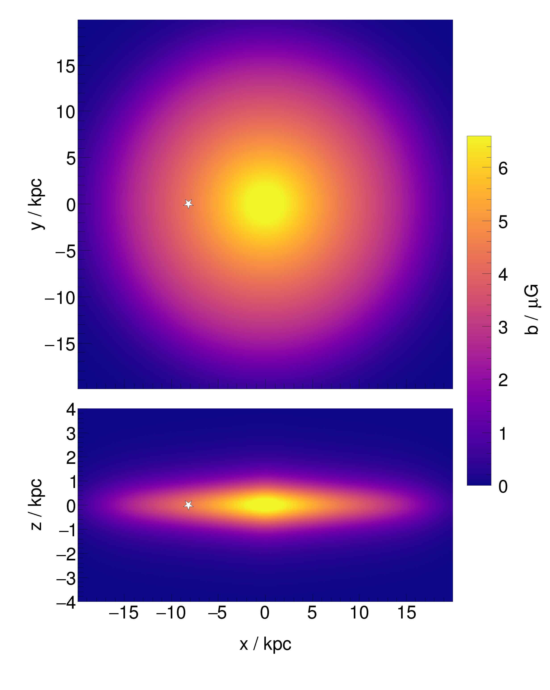
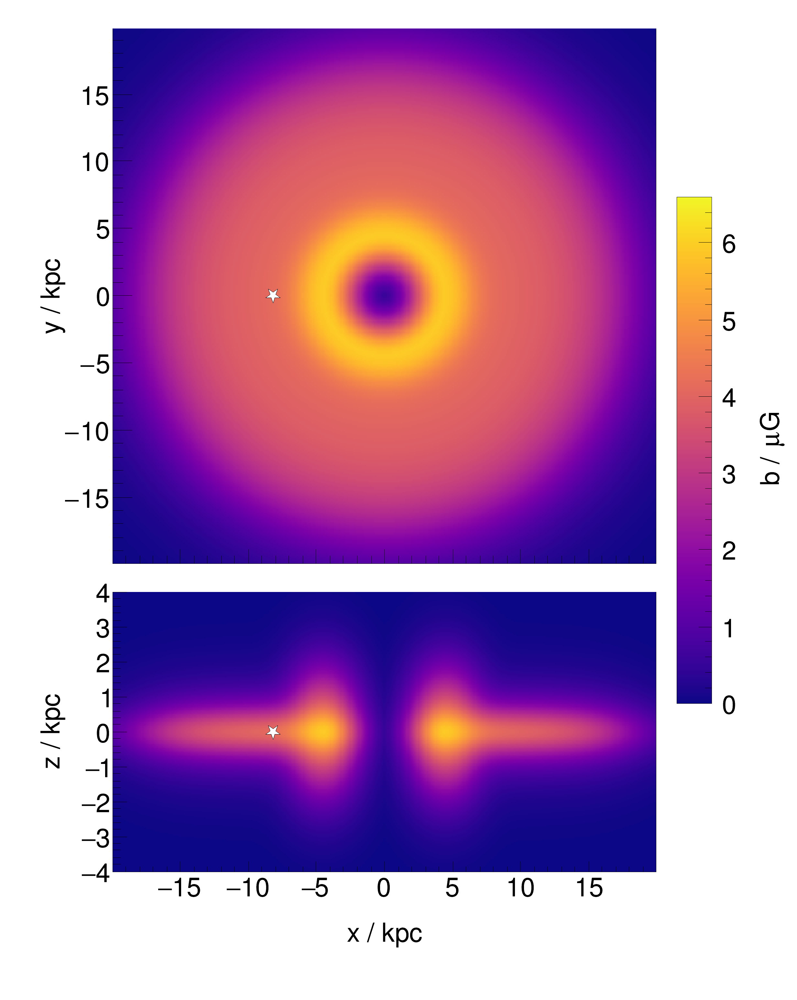

# UF26 Random Galactic Magnetic Field Models

[](https://arxiv.org/abs/2608.21293)

C++ implementation of the random Galactic magnetic field models from the paper
[The Random Magnetic Field of the Milky Way](https://arxiv.org/abs/2608.21293)
by [Michael Unger](mailto:michael.unger@kit.edu) and
[Glennys R. Farrar](mailto:gf25@nyu.edu). Our coherent field models of the
are available at
[GalacticMagneticFieldUF23](https://github.com/MichaelUnger/GalacticMagneticFieldUF23).

<table>
  <tr>
    <td align="center"></td>
    <td align="center"></td>
  </tr>
  <tr>
    <td align="center"><code>expDisk</code></td>
    <td align="center"><code>ringDisk</code></td>
  </tr>
</table>

*rms strength of the random field in the Galactic plane (top) and in the
plane through the Sun (star) and the Galactic center perpendicular to the
disk (bottom).*

## Models

The models describe the rms strength *b* of the isotropic random field,
averaged over volumes large compared to its coherence length. Each Cartesian
component of the field has an rms of *b*/√3. Two models are provided
(Table 2 of the paper):

- `expDisk`: a vertically thin disk, exponential in radius with a smoothed
  central cusp,
- `ringDisk`: a radially flat disk plus an annular enhancement in the inner
  Galaxy, added in quadrature.

## Usage

To calculate the field of the models, only the code implemented in the
`UF26Field` class is needed. E.g., the rms strength of the random field of the
`expDisk` model at a certain position can be obtained as

```cpp
const UF26Field uf26Field(UF26Field::expDisk);
const Vector3 position(1, 3, 2);
const double b = uf26Field(position);
cout << b << endl;
```

Here the constructor takes an argument specifying one of the two UF26 models
(`expDisk` or `ringDisk`). The position is given in Cartesian galacto-centric
coordinates in units of kpc (Earth at negative *x*, North at positive *z*,
Sun at a distance of 8.178 kpc from the Galactic center). The unit of the
returned rms field strength is μG (micro-Gauss). The two components of
`ringDisk` are also available separately via `GetDiskField()` and
`GetAnnularField()`.

## Example program

Type

```
make
```

to compile a simple example program. Then type e.g.

```
./calcUF26Field expDisk -8.178 0 0
```

to obtain the following output:

```
(x,y,z) = (-8.1780e+00, 0.0000e+00, 0.0000e+00) kpc
b_rms   = 4.3678e+00 microgauss
```

Note: this is just a test program. If many evaluations are needed it is
inefficient to execute `calcUF26Field` repeatedly. For that case it is better
to implement a loop over positions inside the code.

## Tests

```
make test
```

compares `UF26Field` to reference values in `Test/referenceValues.txt`,
calculated with the code used for the fits in the paper. The reference file
is produced by `Test/makeReferenceValues.sh`.

## Python bindings

If `pybind11` is installed, then Python bindings can be compiled via

```
make pybind
```

Then test via

```
python3 Python/uf26_field.py
```

## License

Released under BSD 2-Clause "Simplified" License.

Please cite [Unger and Farrar (2026)](https://arxiv.org/abs/2608.21293) if
you find this code useful in your research. The BibTeX entry for the paper
is:

```
@article{UngerFarrar2026,
    author = "Unger, Michael and Farrar, Glennys R.",
    title = "{The Random Magnetic Field of the Milky Way}",
    eprint = "2608.21293",
    archivePrefix = "arXiv",
    primaryClass = "astro-ph.GA",
    year = "2026"
}
```
